# VTT Roadmap

> Master overview only. Detailed tasks live in per-feature docs under `.project/features/`.

## Feature Status

| Slug         | Feature          | Phases                    | Status      | Current Phase |
| ------------ | ---------------- | ------------------------- | ----------- | ------------- |
| `auth`       | Auth & Sessions  | 1A–1B                     | In Progress | 1A Complete   |
| `portal`     | Portal           | 2A–2B                     | In Progress | 2A Complete   |
| `campaigns`  | Campaigns        | 3A–3D                     | In Progress | 3C Complete   |
| `play-area`  | Play Area        | 4A–4M, 4F.1–4F.5, PM1–PM6 | In Progress | PM4 Complete  |
| `editor`     | Campaign Editor  | 5A–5J, 5A.1               | In Progress | 5H Complete  |
| `characters` | Character Sheets | 6A–6G                     | In Progress | 6D Complete   |
| `story`      | Story            | 7A–7D                     | Not Started | —             |
| `bestiary`   | Bestiary         | 8A–8E                     | Not Started | —             |
| `dice`       | Dice             | 9A–9F                     | In Progress | 9F Complete   |
| `inventory`  | Inventory        | 10A–10E                   | Not Started | —             |

> **Editor phase names updated 2026-06-10:** 5A → "Editor Mode & Asset Library", 5E → "Grid Alignment Tool"

## Cross-Cutting

| Phase | Name                       | Status   |
| ----- | -------------------------- | -------- |
| 0     | Foundation & Project Setup | Complete |

## Dependency Graph

```mermaid
graph TD
    P0[Phase 0: Foundation] --> A1A[auth 1A]
    A1A --> A1B[auth 1B]
    A1A --> PO2A[portal 2A]
    PO2A --> PO2B[portal 2B: Activity Feed]
    C3A --> PO2B
    PO2A --> C3A[campaigns 3A]
    C3A --> C3B[campaigns 3B]
    C3A --> PA4A[play-area 4A]
    C3A --> E5A[editor 5A]
    C3A --> CH6A[characters 6A]
    PA4A --> PA4B[play-area 4B]
    PA4A --> PA4F[play-area 4F: Fog]
    PA4A --> E5A
    PA4B --> PA4C[play-area 4C]
    PA4C --> PA4D[play-area 4D: Chat]
    PA4D --> PA4E[play-area 4E: Dice]
    PA4E --> PA4G[play-area 4G: Player & NPC Tokens]
    PA4F --> PA4F1[play-area 4F.1: Token Vision]
    PA4G --> PA4F1
    PA4F1 --> PA4F2[play-area 4F.2: NPC Subtypes]
    PA4F2 --> PA4F3[play-area 4F.3: Canvas Toolbar]
    PA4F3 --> PA4F4[play-area 4F.4: Fog Toolbar]
    PA4F3 --> PA4F5[play-area 4F.5: NPC Placement]
    PA4F3 --> PA4J[play-area 4J: Measure Tool]
    PA4F3 --> PA4K[play-area 4K: Drawing Tools]
    PA4F3 --> PA4H[play-area 4H: Initiative]
    PA4C --> PA4I[play-area 4I: Auras]
    CH6A --> PA4H
    E5A --> E5A1[editor 5A.1: Built-in Assets]
    E5A1 --> E5B
    E5B --> E5C[editor 5C: Layer Mgmt]
    E5B --> E5E[editor 5E: Grid Align]
    CH6A --> CH6B[characters 6B]
    CH6A --> CH6D[characters 6D]
    CH6A --> CH6E[characters 6E: Export]
    PA4B --> CH6B
    PA4E --> CH6C[characters 6C]
    CH6A --> CH6C
    PA4E --> PAPM1[play-area PM1: 3D Dice]
    PA4F --> PAPM2[play-area PM2: Fog Optimized]
    E5E --> E5F[editor 5F: Wall Authoring]
    E5E --> E5G[editor 5G: Light Authoring]
    PAPM2 --> E5F
    PAPM2 --> E5G
    PAPM2 --> PAPM3[play-area PM3: LOS Runtime]
    E5F --> PAPM3
    PAPM2 --> PAPM4[play-area PM4: Light Rendering]
    E5G --> PAPM4
    PA4A --> PAPM5[play-area PM5: Weather]
    E5G --> E5J[editor 5J: Weather Panel]
    E5J --> PAPM5
    PAPM3 --> PAPM6[play-area PM6: Advanced Vision]
    PAPM4 --> PAPM6
    E5G --> E5H[editor 5H: Scene Library]
    E5H --> PA4L[play-area 4L: Scene Switching]
    PA4L --> PA4M[play-area 4M: Scene Bundle]
    E5H --> E5I[editor 5I: Scene Templates]
    PA4L --> E5I
    C3A --> C3C[campaigns 3C: Game Systems]
    CH6A --> CH6F[characters 6F: System Sheets]
    C3C --> CH6F
    CH6F --> CH6G[characters 6G: Progression]
    C3A --> ST7A[story 7A: Chapters & Journal]
    ST7A --> ST7B[story 7B: Handouts]
    PA4C --> ST7B
    ST7A --> ST7C[story 7C: Quest Tracker]
    ST7A --> ST7D[story 7D: Chapter Scene Links]
    PA4L --> ST7D
    C3C --> BE8A[bestiary 8A: Creature Library]
    BE8A --> BE8B[bestiary 8B: Creature Tokens]
    PA4F5 --> BE8B
    BE8B --> BE8C[bestiary 8C: Stat Block Rolling]
    PA4E --> BE8C
    PA4H --> BE8C
    BE8A --> BE8D[bestiary 8D: Import & Export]
    BE8A --> BE8E[bestiary 8E: Loot Tables]
    BE8D --> BE8E
    INV10E --> BE8E
    C3C --> C3D[campaigns 3D: DM Hub]
    E5H --> C3D
    ST7A --> C3D
    BE8A --> C3D
    P0 --> DI9A[dice 9A: Advanced Expressions]
    P0 --> DI9B[dice 9B: Roll Visibility]
    P0 --> DI9E[dice 9E: Dice Skins]
    P0 --> DI9F[dice 9F: Dice Extraction]
    DI9A --> DI9C[dice 9C: Roll Macros]
    DI9B --> DI9D[dice 9D: Roll History & Stats]
    C3A --> INV10A[inventory 10A: Item Catalog]
    CH6A --> INV10A
    INV10A --> INV10B[inventory 10B: Character Inventory]
    INV10B --> INV10C[inventory 10C: Transfers & Party Loot]
    INV10C --> BE8E
    INV10A --> INV10D[inventory 10D: Merchant Stores]
    BE8A --> INV10D
    INV10C --> INV10E[inventory 10E: Trading & Transactions]
    INV10D --> INV10E
```

## Feature Docs

Each feature has its own detailed document with phases, tasks, and decisions:

- [`.project/features/portal.md`](features/portal.md)
- [`.project/features/auth.md`](features/auth.md)
- [`.project/features/campaigns.md`](features/campaigns.md)
- [`.project/features/play-area.md`](features/play-area.md)
- [`.project/features/editor.md`](features/editor.md)
- [`.project/features/characters.md`](features/characters.md)
- [`.project/features/story.md`](features/story.md)
- [`.project/features/bestiary.md`](features/bestiary.md)
- [`.project/features/dice.md`](features/dice.md)
- [`.project/features/inventory.md`](features/inventory.md)
- [`.project/foundation.md`](foundation.md) — Phase 0: Foundation & Project Setup

## Phase 0: Foundation & Project Setup

See [`.project/foundation.md`](foundation.md) for tasks and status.

## Future (Post-MVP)

- Advanced authentication (WebAuthn, OAuth, MFA, rate limiting)
- Advanced combat engine (NPC stat blocks, automated attack rolls, damage resistance/vulnerability, AoE rendering, encounter difficulty calculator, combat log)
- Sound & ambience (integrated soundboard)
- Built-in voice & video chat
- Instant join via URL codes
- Compendium / rule lookup system
